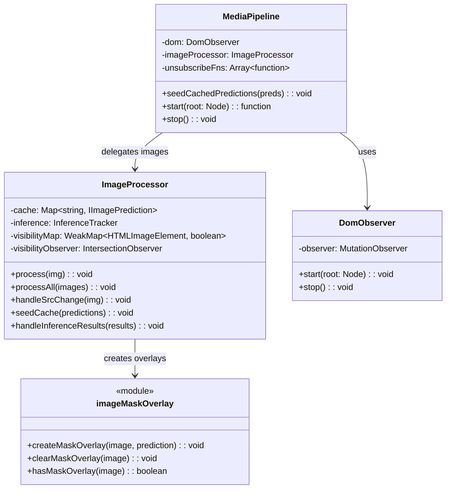

# Media Processing

This document describes the content script's media processing system - both the architectural design
and module-level implementation details.

The content script lives in `entrypoints/content/`. It runs on web pages to observe the DOM, queue
inference, and apply masking styles to images and videos.

## Vocabulary

**Verdict**: The final safe/unsafe decision for a piece of media, produced by aggregating one or
more predictions. _Avoid_: result, outcome, classification

**Prediction**: The model's detections for a single inferred input (one image, one GIF frame, one
video frame). _Avoid_: inference result, detection set

**Fail-closed**: The protection stance while a verdict is genuinely pending: the media stays masked
rather than being revealed. When analysis is permanently impossible, the media is allowed instead
(inference-impossible is not evidence of unsafe content). _Avoid_: fail-safe (ambiguous about
direction)

Video-processing vocabulary (VideoSession, Thumbnail, Bitstream Tap, Lookahead Analysis, Live
Masking, Sample Lattice, Verdict Timeline) lives in [VIDEO_PROCESSING.md](VIDEO_PROCESSING.md).

## Design Principles

1. **Derive state from DOM** - Don't track state separately; read it from CSS classes and overlays
2. **Idempotent operations** - Applying blur twice = no-op, safe to retry
3. **Fire and forget** - Queue async work, never block the observer
4. **Last write wins** - No version tracking; latest prediction for a src just overwrites
5. **Self-cleaning overlays** - Overlays detect when their image changes and clean themselves

## Architecture Overview

The content script follows a modular architecture with clear separation of concerns:

- **Entry Point** (`entrypoints/content/index.ts`) - Initialization and lifecycle management
- **Core** (`core/`) - DOM observation, image processing, media pipeline orchestration
- **Communication** (`communication/`) - Two-way messaging with the background script
- **Hooks** (`hooks/`) - Content-script initialization helpers (settings + cached predictions)
- **Presentation** (`presentation/`) - Visual styling, effects, and CSS injection
- **Handlers** (`handlers/`) - Video-specific handling
- **Video** (`video/`) - Frame capture + playback loop utilities
- **GIF** (`gif/`) - Animated GIF detection, frame decoding, and inference sampling →
  [GIF_PROCESSING.md](GIF_PROCESSING.md)

## Module Descriptions

### Entry Point

#### `index.ts`

The main content script entry point that orchestrates the entire media filtering system. It:

- Initializes global hiding styles to prevent content flash
- Uses the `useHostData` hook to get host settings and cached predictions
- Creates and manages content flow using `MediaPipeline` based on host policy
- Sets up inference result listeners for real-time AI predictions
- Deliberately does **no** unload cleanup: after a refresh/navigation the old page stays painted
  until the next document arrives, and tearing masks down in `beforeunload` would uncover everything
  during that window (and leave a dead pipeline if the navigation is canceled)

### Core (`core/`)

#### `core/DomObserver.ts`

Clean MutationObserver wrapper that directly processes DOM changes and emits structured callbacks
for media element lifecycle events.

**Key Features:**

- Scans existing DOM elements on startup to catch pre-existing media
- Processes added/removed nodes with nested element detection
- Monitors attribute changes for media elements
- Observes source attributes: `src`, `srcset`, `data-src`, `data-srcset`, `data-lazy-src`
- Supports reactive frameworks (Vue/React/Angular) that dynamically change `src`
- **Pierces open shadow DOM**: every discovered open shadow root is scanned and observed with its
  own MutationObserver (a document observer cannot see inside shadow trees). Custom elements seen
  _without_ a shadow root are re-checked on a slow interval — `attachShadow` often runs long after
  insertion (async-loaded components: Reddit's `<shreddit-player>` sits behind
  `<shreddit-async-loader>`, and its `<video>` is born inside the root minutes of churn later).
  Closed shadow roots remain invisible (accepted limitation)

#### `core/ImageProcessor.ts`

Handles image processing with DOM-derived state (no dataset attributes). Animated GIFs are ``
elements too, so this processor also routes GIF candidates to a multi-frame inference path; see
[GIF_PROCESSING.md](GIF_PROCESSING.md).

**Key Features:**

- State derived from blur class and overlay presence
- In-memory cache for predictions (Map<src, prediction>)
- Deduplicates inference requests via the owner-tracking `InferenceTracker`
  (`core/inferenceTracker.ts`, see [Inference Requests](#inference-requests))
- Idempotent operations - safe to call multiple times
- Self-cleaning overlays via `trackedSrc` tracking
- Viewport-based priority via `IntersectionObserver` (visible images processed first)

**Public API:**

```typescript
class ImageProcessor {
  process(img: HTMLImageElement): void;
  processAll(images: HTMLImageElement[]): void;
  handleSrcChange(img: HTMLImageElement): void;
  seedCache(predictions: IImagePrediction[]): void;
  handleInferenceResults(results: ImageInferenceResult[]): void;
}
```

#### `core/MediaPipeline.ts`

The main orchestrator that combines DOM observation with image/video processing.

**Key Features:**

- Uses `DomObserver` for DOM change detection
- Delegates image processing to `ImageProcessor`
- Handles video processing via `VideoProcessor`
- Subscribes to prediction broadcasts from background
- Manages cleanup and resource disposal
- Video sessions additionally suspend outside a 400 px viewport margin (after a 1 s grace period, so
  boundary flapping cannot thrash Live Masking and lookahead priority), because feed players can
  remain connected and autoplay after they have been scrolled away

### Communication (`communication/`)

#### `listener.ts`

Handles all inbound messages from the background script.

**Message Types:**

- `ON_HOST_SETTINGS_UPDATED` - Notifies when host settings change
- `ON_INFERENCE_PREDICTIONS` - Delivers AI prediction results (images)
- `ON_FRAME_PREDICTIONS` - Delivers AI prediction results (video frames)

#### `sender.ts`

Manages all outbound communication to the background script.

**Key Functions:**

- `requestHostSettings()` - Gets current host settings
- `requestCachedPredictions()` - Retrieves cached AI predictions
- `requestImageInference()` - Sends image for AI processing
- `requestHostData()` - Parallel fetch of settings and predictions

### Hooks (`hooks/`)

#### `useHostData.ts`

Unified initializer for fetching host settings and cached predictions from the background.

**Return Interface:**

```typescript
{
  settings: IHostSettings;
  predictions: IImagePrediction[];
  isLoading: () => boolean;
  refresh: () => Promise<void>;
  cleanup: () => void;
}
```

### Presentation (`presentation/`)

#### `styleInjecting.ts`

Core CSS injection module that handles global style management.

- `injectGlobalHidingDomStyles()` - Prevents showing browser-cached images before DOM load
- `injectPredictionDomStyles()` - Injects CSS classes for blur effects and overlays

#### `initialStyling.ts`

Handles initial protective styling applied to media elements before AI analysis.

- `applyInitialImageStyling()` - Applies protective blur while waiting for AI analysis
- `resetImageStyling()` - Clears all styling for reprocessing
- `finalizeImageProcessing()` - Removes styling and sets final processed status
  (safe/unsafe/skipped)

##### Processed Status Attributes

Media elements can expose their final processing outcome via boolean data attributes. These are set
by `finalizeImageProcessing(image, status)` and cleared by `resetImageStyling(image)`.

- `data-haramblock-processed-safe` — AI found no unsafe content
- `data-haramblock-processed-unsafe` — AI detected unsafe content
- `data-haramblock-processed-skipped` — Processing was skipped (unsupported format, too small, or
  error)

Notes:

- Exactly one of these attributes is present after finalization; all are removed on reset or when
  the image `src` changes.
- Use them for CSS hooks or analytics. Example CSS:

```css
img[data-haramblock-processed-unsafe] {
  outline: 2px solid rgba(255, 0, 0, 0.4);
}
img[data-haramblock-processed-safe] {
  outline: 1px dashed rgba(0, 128, 0, 0.3);
}
```

#### `predictionStyling.ts`

Handles AI prediction-based styling application.

- `applyPredictionsStyling()` - Applies AI-based styling using segmentation mask overlays
- Overlay creation is deferred one animation frame; an image a framework re-render detached in that
  window is waited for by the overlay anchor (see `overlayAnchor.ts`)

#### `imageMaskOverlay.ts`

Segmentation-based visual overlays using canvas and mask data. The overlay is a `<div>` (with a
`<canvas>` child) homed by the overlay anchor as the image's next sibling; the module itself only
paints.

- Creates pixelated overlay effects using RLE-encoded segmentation masks
- Unified canvas approach combining multiple masks into single overlay
- When the image collapses to zero size (e.g. a lightbox hides it) the canvas is also cleared, so a
  stale painted frame can never show at its old size
- **Site-obscured copies**: when the site itself blurs an image at least as strongly as our own
  initial blur (15px — e.g. Reddit's decorative background copy uses `blur(24px)` + `opacity: .3`),
  our mask is hidden: an opaque pixelated slab would be _more_ visible than the original.
  Re-evaluated on every layout

#### `overlayAnchor.ts`

`anchorOverlay(element, overlay, { stacking?, trackSrc?, onLayout?, onLost })` returns
`{ refresh(), dispose() }` and owns the placement lifecycle for every DOM-injected overlay (image
mask, GIF player, video Mask Presenter, quick-toggle button). Adapters only paint in `onLayout`.
Nothing is placed until the first `refresh()`, which re-homes, re-measures and paints synchronously
and returns the geometry (`null` while the element cannot be placed).

- **Homing**: a `cover` goes in as the element's next sibling mirroring its z-index, so player
  chrome stacked above the element stays above the mask (Facebook Reels' Unmute button);
  fixed-position elements use container injection with z + 1. A `badge` (quick toggle) is appended
  into the container at z + 2. Shadow-DOM aware: for an element that is a **direct child of a shadow
  root** (Reddit's `<shreddit-player>` renders its `<video>` that way; `parentElement` is null) the
  overlay lives in the shadow root while the positioned shadow **host** is the containing block
- **Position context**: forces `position: relative` only while the containing block computes to
  `static`, marks it (`data-haramblock-forced-position`), and **re-evaluates on every refresh**:
  site styles applied later (Reddit's `<zoomable-img>` gains `position: fixed` when zoomed) must
  win. Runs before the box rect is read
- **Offsets** are converted into the box's **content coordinates** by adding back
  `scrollTop`/`scrollLeft` (Reddit's zoom view scrolls to center the click point); a viewport-fixed
  element gets a `position: fixed` overlay at its viewport coordinates
- **Tracking**: a `ResizeObserver` on the element **and its box** (a parent resize moves the
  element's offsets even when its size is unchanged — flex re-centering, custom-element upgrade)
  refreshes synchronously, so a re-attached element is covered before paint; mutations, viewport
  resize and scroll refresh coalesced on the next animation frame
- **Detachment** (see [Surviving Framework Re-renders](#surviving-framework-re-renders)): the
  overlay leaves the page while its element is disconnected and comes back when the element does;
  after 30 frames the anchor gives up with `onLost('detached')`
- **Source drift** (`trackSrc`, images): a changed `currentSrc` ends the overlay with
  `onLost('src-drift')` and routes the image back into the pipeline (`srcDrift.ts`)

## Initialization: Preventing Flash of Unfiltered Content

Browser-cached images can render before the content script has a chance to process them. To prevent
this "flash of unfiltered content":

```
document_start (earliest possible)
       │
       ▼
Inject global startup hiding: img, video, shreddit-player { opacity: 0 !important; }
       │
       ▼
Fetch host settings + cached predictions (async)
       │
       ▼
DOMContentLoaded
       │
       ▼
Start MediaPipeline (processes existing images, applies blur/overlays)
       │
       ▼
Remove global hiding style
       │
       └── Images now visible with appropriate blur/overlay applied
```

**Key points:**

- `runAt: 'document_start'` ensures we inject hiding style before any images render
- Global `opacity: 0` hides ALL images until we're ready
- Removal happens AFTER pipeline starts, so images are already protected
- If whitelist policy or error, hiding is removed immediately (no processing needed)

This is **separate from per-image blur** - the global hide is a startup-only safeguard, while blur
class is the ongoing protection during inference.

## State Model

State is **derived from DOM**, not tracked separately:

| DOM Condition              | Derived State   | Meaning               |
| -------------------------- | --------------- | --------------------- |
| No blur class, no overlay  | **Unprocessed** | Needs processing      |
| Has blur class, no overlay | **Pending**     | Waiting for inference |
| Has overlay (± blur class) | **Complete**    | Prediction applied    |

```typescript
// State derived from DOM - no tracking needed
function getState(img: HTMLImageElement): 'unprocessed' | 'pending' | 'complete' {
  if (hasOverlay(img)) return 'complete';
  if (hasBlurClass(img)) return 'pending';
  return 'unprocessed';
}
```

## Processing Flow

### MutationObserver Callback (Must be fast!)

```
onMediaAdded/onAttributesChanged(img)
       │
       ├── Has overlay for CURRENT src? → Done (already complete)
       │
       ├── In cache? → Apply prediction immediately
       │
       └── Neither? → Apply blur, queue inference

Total blocking time: ~1ms (just class manipulation)
```

### Inference Queue (Async, non-blocking)

```
queueInference(img, src)
       │
       ▼
[Async] Wait for load if needed
       │
       ▼
Check visibility (IntersectionObserver)
       │
       ▼
[Async] Send to background with priority
       │
       └── No callbacks, no state updates
           Background will broadcast prediction when ready
```

### Viewport-Based Priority

Images visible in the viewport are processed before offscreen images. This improves perceived
performance by prioritizing above-the-fold content.

**How it works:**

1. `ImageProcessor` maintains an `IntersectionObserver` that tracks image visibility
2. When an image is queued for inference, its visibility is checked
3. Visible images get `priority=30`, offscreen images get `priority=0`
4. The background queue (p-queue) processes higher priority tasks first

```typescript
// In ImageProcessor
this.visibilityObserver = new IntersectionObserver(
  entries => {
    for (const entry of entries) {
      this.visibilityMap.set(entry.target, entry.isIntersecting);
    }
  },
  { rootMargin: '200px' } // Pre-fetch slightly outside viewport
);

// When sending for inference
const isVisible = this.visibilityMap.get(img) ?? false;
const priority = isVisible ? PRIORITY_VISIBLE : PRIORITY_OFFSCREEN;
await requestImageInference(hostname, img, priority);
```

**Priority values:**

| Media Type       | Priority | Description                                  |
| ---------------- | -------- | -------------------------------------------- |
| Visible images   | 30       | First at the next available inference slot   |
| Video thumbnails | 20       | Initial verdict before continuous video work |
| Video frames     | 10       | Active playback                              |
| Offscreen images | 0        | Below fold or hidden                         |

**Note:** p-queue uses higher number = higher priority (runs first). An inference run already in
progress is not preempted. The same ordering is applied when the dynamic-batch collector chooses the
next batch, so autoplay frames cannot build an equal-priority backlog ahead of newly queued visible
images. GIF frame samples use their image's visible/offscreen priority.

### Prediction Broadcast (Background → Content)

```
onPrediction({ src, predictions })
       │
       ▼
Find all img elements with this src
       │
       ▼
For each: apply overlay, remove blur class
       │
       └── If img.src changed, overlay auto-cleans via ResizeObserver
```

### Why One-By-One (Not Batched)

Images are processed individually by design. This enables priority ordering (visible images before
offscreen), predictable memory usage, and isolated error handling. Arrays in the API
(`handleInferenceResults[]`, `seedCache[]`) exist for receiving cached predictions on page load, not
for batch sending.

## Handling Source Changes

Instead of complex version tracking, use **idempotent re-detection**:

```
src changes (MutationObserver fires)
       │
       ▼
handleSrcChange(img)
       │
       ├── Clear existing overlays
       │
       └── Process as new image:
              ├── Check cache for new src
              ├── Apply blur if not cached
              └── Queue inference if needed
```

### Self-Cleaning Overlays

Image and GIF overlays anchor with `trackSrc`: the overlay anchor remembers the source the overlay
was created for and, on any refresh (resize observation included) that finds a different
`currentSrc`, disposes the overlay via `onLost('src-drift')` and routes the image back into the
pipeline through `notifySrcDrift`.

## Surviving Framework Re-renders

Frameworks believe they own the DOM we inject overlays into. Reddit's Lit-rendered lightbox is the
stress case: it renders the same picture as several `` copies, constantly detaches and
re-inserts nodes during re-renders, and moves the post image between containers. Three defensive
patterns keep masks alive through that churn:

1. **Connectivity, not removal, decides.** A cleanup observer used to treat any `removedNodes` batch
   containing the element (or an ancestor) as removal — but a re-render usually re-inserts the node
   within the same batch, so that signal tore masks off still-visible images (fail-open). The
   overlay anchor re-homes on such a batch and lets `element.isConnected` decide: a moved element
   gets its overlay next to it again (also covering the site deleting the overlay itself), a
   disconnected one has its overlay taken off the page until it returns.

2. **Wait for re-attachment.** Overlay creation runs one animation frame after the prediction
   arrives; an element detached at creation or later is waited for (bounded, 30 frames) before the
   anchor gives up. `hasMaskOverlay()` reports a state whose overlay is off the page as inactive, so
   the next processing pass can recreate it instead of being blocked by stale bookkeeping.

3. **One teardown path.** All disposal (explicit clear, quick-toggle reveal, detach) goes through
   the same full teardown. A "detach the overlay but keep the state" half-state would fight the
   re-homing logic in (1), which would immediately re-attach the mask the user just revealed.

## Race Conditions - Why They Don't Matter

### Old Pattern (Complex)

```
t=0: Inference starts for src=A
t=1: src changes to B
t=2: Inference for A completes
t=3: Check version... reject... complex logic...
```

### New Pattern (Simple)

```
t=0: Inference starts for src=A
t=1: src changes to B, blur applied, new inference queued
t=2: Inference for A completes, tries to find img[src=A]
t=3: No match found (src is now B), prediction cached but not applied
t=4: Inference for B completes, applies to img[src=B] ✓
```

**Key insight**: Predictions are matched by `src`, not by element reference. If the src changed, the
old prediction simply won't find any matching elements.

## Handling Rapid Source Changes (Google Images)

Some sites like Google Images rapidly change image `src` attributes for quality upgrades, lazy
loading, or A/B testing. This creates a challenge where by the time an image loads, its src has
already changed multiple times.

### The Problem

```
t=0: Image added with src=A (low quality placeholder)
t=1: queueInference(src=A), attach load listener
t=2: Google changes src to B (medium quality)
t=3: handleSrcChange fires, queueInference(src=B)
t=4: Google changes src to C (high quality)
t=5: handleSrcChange fires, queueInference(src=C)
t=6: Load listener for A fires, but currentSrc is now C → abort
t=7: Load listener for B fires, but currentSrc is now C → abort
t=8: Image stuck with blur forever (no inference ever sent for C)
```

### The Solution: Debounced Source Change Handling

Instead of immediately processing on every src change, we **debounce** the processing:

The handler first compares the element's resolved `currentSrc || src` with the last source processed
for that element. Frameworks such as Reddit frequently re-stamp unchanged `src`/`srcset` attributes;
those no-op mutations must not clear a completed overlay or continually reset the debounce.

```typescript
const SRC_STABILIZATION_DELAY = 150; // ms

handleSrcChange(img: HTMLImageElement): void {
  // Clear overlays and apply blur immediately (visual feedback)
  this.clearOverlays(img);
  if (!this.hasBlurClass(img)) {
    applyInitialImageStyling(img, this.hostSettings);
  }

  // Cancel any pending debounce for this image
  const existingTimeout = this.srcChangeDebounce.get(img);
  if (existingTimeout) clearTimeout(existingTimeout);

  // Wait for src to stabilize before processing
  const timeout = setTimeout(() => {
    this.srcChangeDebounce.delete(img);
    this.process(img);
  }, SRC_STABILIZATION_DELAY);

  this.srcChangeDebounce.set(img, timeout);
}
```

**Result:**

```
t=0-5: Multiple src changes, debounce keeps resetting
t=6: src stabilizes at C
t=7: 150ms passes with no changes
t=8: Debounce fires, process(img) with src=C
t=9: Inference sent for C, prediction applied ✓
```

### Resolving the Source Under Firefox's Pending Request

Every "what is this image's URL" read goes through `resolveImageSource(img)` instead of a bare
`img.currentSrc || img.src`. Firefox keeps `currentSrc` on the **previous** request until the new
image's size is known, so right after `img.src = next` the mutation callback still reads the old
URL. On Google Images that made the placeholder→thumbnail swap (`…&s=10` → `…&s`) look like a no-op
re-stamp: the 10 px placeholder's `safe` verdict stayed on the element and the full thumbnail
rendered bare. For images without `srcset`/`<picture>` the reflected `src` is authoritative;
candidate selection keeps using `currentSrc`. As a second net, `process()` registers one `load`
listener per image that re-runs `handleSrcChange` whenever the resolved source no longer matches the
one last processed (also covers srcset re-selection on images that carry no overlay).

Once such a placeholder has decoded, `isPlaceholderResolution` (both natural sides under 32 px, or
under the host's configured minimum size when that is smaller) finalizes it as `skipped` instead of
inferring it: a 10 px image carries nothing to detect, and on a single-lane mobile queue those
placeholders were the bulk of the backlog ahead of real thumbnails. The swap to the real source
re-enters processing as described above.

### Robust Image Load Detection

For images that aren't yet loaded, we use **both** `decode()` and `load` event - whichever fires
first wins:

```typescript
if (img.complete && img.naturalWidth > 0) {
  void sendRequest();
} else {
  let handled = false;
  const onReady = () => {
    if (handled) return;
    handled = true;
    void sendRequest();
  };

  // decode() rejection is only fatal when the browser has given up on the
  // image (complete with no dimensions); otherwise the load/error events decide.
  img.decode().then(onReady, reason => {
    if (img.complete && img.naturalWidth === 0) handleError(reason);
  });
  img.addEventListener('load', onReady, { once: true });
  img.addEventListener('error', handleError, { once: true });
}
```

This handles edge cases where:

- `decode()` resolves but `load` never fires (cached images)
- `load` fires but `decode()` rejects (CORS issues)
- Image fails to load (network error)
- `decode()` rejects spuriously — Firefox rejects for `loading="lazy"` images that haven't started
  loading (Reddit's feed) and for `src` swaps mid-decode. Treating those rejections as fatal would
  remove the blur and reveal the image unmasked, with the later `load` event ignored. Instead the
  blur stays on (fail-closed) until `load`/`error` fires.

### Finding Images by Resolved URL

When predictions come back, we need to find matching images. CSS attribute selectors match the
**literal attribute value**, not the resolved URL:

```html

<!-- img.src returns "https://example.com/images/photo.jpg" -->
<!-- but img[src="https://..."] won't match! -->
```

**Solution:** Query pending images and compare resolved `src` property:

```typescript
private findImagesBySrc(src: string): HTMLImageElement[] {
  const results: HTMLImageElement[] = [];
  const pendingImages = document.querySelectorAll<HTMLImageElement>(
    `img.${BLUR_CLASS}, img.${BLACKLIST_CLASS}`
  );

  for (const img of pendingImages) {
    const imgSrc = img.currentSrc || img.src;
    if (imgSrc === src) {
      results.push(img);
    }
  }

  return results;
}
```

## Image Scaling and Letterboxing

This section documents how segmentation masks are mapped from model space back to the on-screen
image when the `` element is resized or uses CSS `object-fit`.

### Coordinate Spaces

- **Original image space**: intrinsic pixels (`naturalWidth` x `naturalHeight`)
- **Model input space**: letterboxed model input (e.g., 640x640) and output mask grid (e.g.,
  160x160)
- **Page element box**: the rendered CSS box (`getBoundingClientRect`)
- **Content rect**: visible image pixels inside the box after `object-fit` is applied

> **srcset pitfall**: for ``, `naturalWidth/naturalHeight`
> are **density-corrected CSS dimensions**, not the loaded resource's pixels (a 944px-wide variant
> can report `naturalWidth = 1199`). They are safe for aspect-ratio math (`object-fit`), but must
> never be used as a `drawImage` **source rect** — source rects are in resource pixel space, and an
> overshooting rect gets clipped with the destination shrunk proportionally, which painted masks
> only over the top-left of Reddit gallery images. Use the 5-arg `drawImage` to map the whole
> source. For the same reason the background derives prediction `width/height` from the decoded
> `ImageBitmap`, not from the element-reported dimensions.

### Letterboxing Transform

During preprocessing, the original image is scaled to fit the model input with letterboxing. The
`calculateScaleFactors()` function returns:

- `offsetX, offsetY`: padding (in grid units) around the scaled image
- `scaleX, scaleY`: convert from grid coords (after removing offset) into original pixel coords

### Content-Side Mapping

Utilities in `imageLayout.ts`:

- `computeRenderedContentRect(image)` - Computes the visible image area inside the element box,
  accounting for `object-fit: fill | contain | cover | none | scale-down`

`maskCoverage.ts` owns the mask grid on the content side:

- `MaskCoverage.from(predictions, maskTransform, originalW, originalH)` - Decodes the RLE masks and
  unions the cells above the 0.5 threshold; the grid window that holds real image pixels (letterbox
  padding excluded) is what gets stretched onto a content rect
- `.rects(contentRect)` - Covered cells merged into rectangles, mapped to element-box pixels (video
  `clip-path`)
- `paintPixelatedMask(ctx, source, coverage, contentRect, masking)` - The image and GIF overlays'
  paint: pixelated `source` within `contentRect`, composited `destination-in` with the coverage
  alpha so only covered pixels keep the mosaic, then tinted via CSS filter

`croppedMaskTransform()` (`utils/croppedMaskTransform.ts`) derives the transform for the cropped
masks the inference library emits (pure scale, zero offset).

## Deduplication

### Inference Requests

In-flight requests are deduplicated by src via `InferenceTracker` (`core/inferenceTracker.ts`),
which records per src the element that **owns** the request — the load listeners that eventually
fire it live on that specific ``. Tracking the owner matters because frameworks can replace the
element before a lazy image loads: its listeners then never fire, and with a plain src set the entry
would stay "pending" forever, dropping every later copy (including visible ones) into a permanent
initial blur. Instead, a new copy **adopts** the request when the owner is disconnected, or when the
owner is stalled (not loaded, e.g. a lazy copy in a hidden subtree) while the new copy already has
pixels. A duplicate send from a superseded owner is harmless — predictions are keyed by src and the
second result is idempotent. The entry is deleted when a prediction for that src arrives.

Once a request is sent, two watchdogs guard the entry. A 120-second send-time guard covers a task
the background lost before it ever ran. The real 20-second inference watchdog starts only when the
background broadcasts `status: 'started'` for the src (the task left the queue), because queue wait
is unbounded on slow devices: single-lane WASM inference on Firefox mobile with a page of offscreen
Google Images ahead easily exceeded 20 s, and a queue-based timeout revealed the whole below-fold
band unmasked. Either watchdog retries once using a loaded, visible same-source copy when possible.
On the second timeout the images **fail closed**: the initial blur stays and the pending entry is
cleared, so the late prediction still applies when it arrives (`findImagesBySrc` matches blurred
images) and any later `process()` pass re-sends. Only an explicit `status: 'error'` result from the
background (inference genuinely impossible) finalizes the copies as `skipped` after two attempts.

The background dedupes as well: a request for a `hostname + src` that is already queued or running
joins the in-flight task instead of enqueueing a second one (retries, extra `` copies, and
other tabs on the same host all receive the single broadcast verdict). A joining request with a
higher priority (a visible copy behind an offscreen one) raises the queued task's priority, and one
that joins a task already running receives the `started` broadcast again so its watchdog arms.

### DOM Processing

Blur class acts as marker - if image has blur class, don't re-apply:

```typescript
function process(img) {
  if (img.classList.contains('haramblock-initial-blur')) {
    return; // Already pending
  }
  img.classList.add('haramblock-initial-blur');
  queueInference(img, img.src);
}
```

## Class Relationships



## Performance Considerations

- **DOM-derived state**: No dataset attributes, state read from blur class and overlay presence
- **Deduplication**: `InferenceTracker` prevents duplicate requests per src
- **Cached predictions**: Previously analyzed images styled immediately from cache
- **Parallel data fetching**: Settings and predictions fetched simultaneously on init
- **RequestAnimationFrame**: Overlay creation batched for smooth rendering
- **Self-cleaning overlays**: No manual cleanup needed when src changes
- **Viewport priority**: Visible images processed first via async `IntersectionObserver` (negligible
  overhead)

| Operation         | Blocking Time | Notes                             |
| ----------------- | ------------- | --------------------------------- |
| Add blur class    | <1ms          | Sync, single classList.add        |
| Check for overlay | <1ms          | Sync, WeakMap lookup              |
| Check visibility  | <1ms          | Sync, WeakMap lookup              |
| Queue inference   | <1ms          | Just adds to Set + posts message  |
| Apply overlay     | ~5-10ms       | Async, uses requestAnimationFrame |
| Remove blur       | <1ms          | Sync, classList.remove            |

**MutationObserver callback total: <3ms** (acceptable for 60fps)

## Error Handling

- Communication failures logged and gracefully handled
- Image loading errors don't prevent processing of other images
- AI processing failures don't affect cached predictions
- Predictions for changed src silently ignored (matched by src, not element)

## Policies

- **Whitelist**: Skip all processing, allow content through
- **Blacklist**: Apply immediate heavy blur/opacity
- **Default (process)**: Apply protective blur while waiting for AI analysis, then apply overlays
